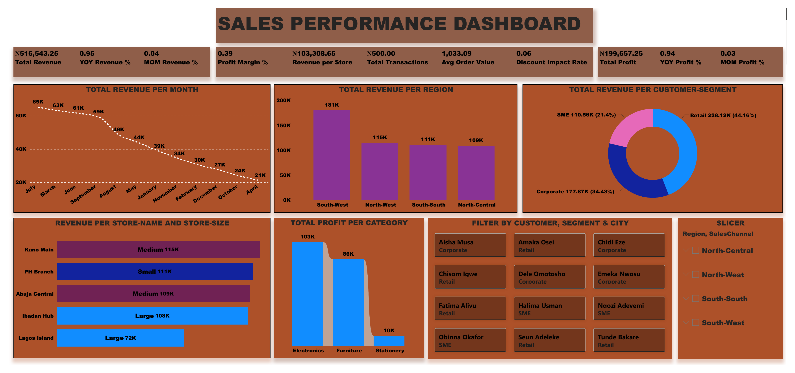

# Sales Performance Dashboard (Power BI)

## Business Problem
A multi-store retail company in Nigeria operates 5 stores across 4 regions, selling Electronics and Furniture through 4 channels (In-Store, Online, Phone, Partner). Despite having over 500 sales transactions logged across 2023 and 2024, the business had no central way to see which stores, regions, channels, or products were actually driving revenue and profit, or how performance was trending over time.

This dashboard brings the transaction data into one Power BI model so management can quickly answer:
- Which stores and regions generate the most revenue and profit?
- How do sales channels compare on volume, revenue, and margin?
- Which product categories and products drive the most profit?
- Is revenue growing month over month and year over year?
- Are promotions actually paying off?
- Which customer segment (Corporate vs Retail) is more valuable?

## Dataset
`Sales_transactions.xlsx`, a star-schema model with 5 sheets: `salesfact` (500 transactions, Jan 2023 to Dec 2024), `DimProducts`, `Dimcustomers`, `DimStore`, and `DimDate`.

This is practice data I built to design and populate the model myself. It is not from a real company.

## Tools
Power BI (data modeling, DAX measures, interactive dashboard)

## KPIs Tracked
7 core measures, each with Prior Year, Year-over-Year %, Prior Month, and Month-over-Month % variants (28 DAX measures total):
- Total Revenue
- Total Profit
- Profit Margin %
- Average Order Value
- Total Transactions
- Revenue per Store
- Discount Impact Rate

## Dashboard Overview
- **KPI cards**: Total Revenue, Total Profit, Profit Margin %, Revenue per Store, Total Transactions, Avg Order Value, Discount Impact Rate, each with YoY and MoM change
- **Total Revenue per Month** (line chart): the full monthly trend from 2023 to 2024
- **Total Revenue per Region** (bar chart)
- **Revenue per Store, colour-coded by store size** (bar chart)
- **Total Revenue per Customer Segment** (donut chart): Corporate vs SME vs Retail
- **Total Profit per Category** (bar chart): Electronics, Furniture, Stationery
- **Slicers**: Region, Sales Channel, Customer, Customer Segment, City

## Key Findings
- **Total revenue was ₦516,543 across 2023 and 2024, with a profit margin of 38.7%.** Average order value was about ₦1,033.
- **Revenue fell from 2023 to 2024** (about 5.5% lower year over year), even though the *number* of transactions rose (237 in 2023 to 263 in 2024). More orders did not translate into more revenue, meaning average order value dropped.
- **Electronics earns the most revenue (about 59% of the total) but carries the lowest margin** among the main categories, while Furniture earns less revenue but at a noticeably higher margin. Chasing electronics volume alone isn't the same as chasing profit.
- **Phone had the most transactions (30.2% of all orders) but Online generated the most revenue** (₦158,995 vs ₦146,084 for Phone). Phone brings in more orders of lower average value; Online brings in fewer, higher-value ones.
- **South-West is the strongest region (about 35% of total revenue, ₦181K)**, well ahead of North-West (₦115K), South-South (₦111K), and North-Central (₦109K).
- **Lagos Island is the weakest individual store (₦72K)**, despite sitting in South-West, the strongest region, and despite being a Large store. Ibadan Hub, the other Large store, earns ₦108K, meaning store size alone doesn't explain performance. Regional strength doesn't guarantee every store in that region performs well.
- **Discounted transactions have a lower profit margin than non-discounted ones** (about 34% vs 43%), while average order value stays roughly the same, so discounts here are eroding margin without a clear volume payoff.

## Recommendations
- Investigate why Lagos Island underperforms relative to Ibadan Hub, despite both being Large stores in the same strong region. It may be a staffing, footfall, or local competition issue worth a site-level review.
- Review discounting policy, particularly in Furniture, since discounted orders lose margin without a matching increase in order size.
- Since Phone drives transaction volume but Online drives revenue, consider whether Phone orders could be upsold toward higher-value items, or whether Online's approach (larger baskets, higher AOV) can be replicated on Phone.

## Data Quality Note
The data model originally had two separate "Region" fields: one describing where each customer lives (`Dimcustomers[Region]`) and one describing where each store is located (`DimStore[Region]`). The dashboard's Region chart and slicer were initially built on the customer's region, which meant the chart showed where customers live rather than where sales actually happened, and it didn't reflect all 5 stores correctly. This was corrected to filter and chart by the store's region instead, since the business questions in the BRD are about store and regional performance, not customer geography. Two fields with the same name from different tables can easily get mixed up in a real data model, and it's worth checking for before a report goes out.

## Files
- `Sales_Performance_Analytics.pbix`: the Power BI file
- `Sales_transactions.xlsx`: the underlying data model
- `dashboard.png`: a screenshot of the dashboard

## Author
Bello Ridwan Oluwadamilare, Data Analyst (University of Ilorin)
